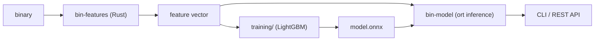

# Maltriage

Static malware triage for executable binaries. Rust feature extraction, LightGBM training, ONNX inference in Rust.

> Status: early scaffold. PE feature extraction and the training pipeline exist; nothing has been trained or benchmarked yet. See [Status](#status).

*Triage* here means what it means in a malware analysis workflow: a fast first-pass score that decides which samples deserve a closer look. It is not a replacement for an antivirus engine or manual analysis.

## Design

- **One feature extractor.** Training and inference use the same Rust code, so there is no train/serve skew. The column order is a contract: `maltriage names` prints it and the ONNX export script checks it.
- **Hostile input.** Files are untrusted. The parser avoids panicking indexing, bounds work per file (file size, string and import caps), does not follow symlinks and never executes anything. A `cargo-fuzz` target is planned.
- **Honest evaluation.** Time-based train/test split, and TPR at fixed low FPR instead of accuracy.
- **Train in Python, infer in Rust.** LightGBM is trained in Python and exported to ONNX; inference will run in Rust via `ort`.

## Architecture



## Status

| Component | State |
|---|---|
| `crates/bin-features`: PE header, sections, imports (hashed), strings, entropy, byte histogram | scaffold, not yet compiled or tested on real data |
| `crates/bin-cli`: `extract` (JSONL, parallel) and `names` | scaffold |
| `training/`: LightGBM training, ONNX export with parity check | scaffold |
| ELF support | planned |
| `bin-model` (ort inference), YARA rules (`yara-x`), REST API (`axum`), fuzzing (`cargo-fuzz`) | planned |

## Quickstart

Requires a Rust toolchain.

```powershell
cargo test --workspace
cargo run -p bin-cli --release -- names
cargo run -p bin-cli --release -- extract C:\Windows\System32 --label benign --out data\benign.jsonl
```

Each output line is one JSON object:

```json
{"path": "...", "sha256": "...", "label": "benign", "features": {"file_size": 12345.0, "...": 0.0}}
```

Files that fail to parse produce `{"path": "...", "error": "..."}`.

## Training

```powershell
cd training
python -m venv ..\.venv; ..\.venv\Scripts\Activate.ps1
pip install -r requirements.txt
python train.py ..\data\benign.jsonl ..\data\malicious.jsonl --meta ..\data\meta.csv
python export_onnx.py
```

`meta.csv` has the columns `sha256,first_seen` and drives the temporal split. Without it the PE header timestamp is used, which is noisy and forgeable.

## Results

Not available yet. This section will contain ROC AUC, TPR at 1% and 0.1% FPR, a per-feature-group ablation and a throughput comparison against a Python baseline, each with the command that reproduces it.

## Data and safety

- Benign: clean system directories plus third-party software, installers and differently built binaries (see the bias note below).
- Malicious: [MalwareBazaar](https://bazaar.abuse.ch/) (abuse.ch). Keep the `first_seen` dates.
- Samples are handled only inside an isolated VM, stored under their SHA256 with no file extension, never executed, and never committed. `samples/` and `data/` are git-ignored. Only hash lists and download scripts belong in the repository.
- Only the extracted feature files (numbers, no executable content) leave the VM.

## Threat model and limitations

- Static features are weak against packed or obfuscated samples, and a motivated adversary can evade a static classifier.
- Dataset bias is the main risk: if benign files are all system binaries and malware is all packed, the model learns the collection, not maliciousness. The benign set must include packed and third-party software.
- Labels are noisy. Benign sets can contain infected files and malware labels depend on the source.
- The score is a triage signal, not a verdict.

## Roadmap

1. First compile, tests and a data collection run.
2. Baseline model and metrics.
3. `bin-model`: ONNX inference in Rust, with a parity test against Python.
4. ELF features and a separate model per format.
5. YARA rule matches in the report, REST API, fuzzing, Docker.

## License and disclaimer

For research and education. Handle malware samples only in isolated environments and follow the terms of the data sources.
